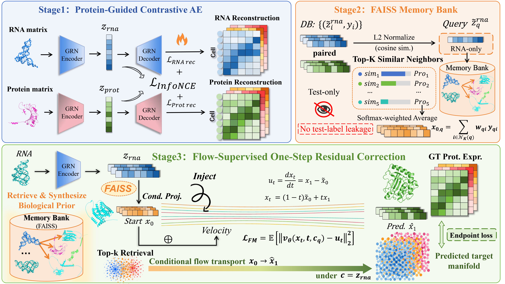

<div align="center">

# scRAC

### Retrieval-augmented correction for single-cell RNA-to-protein prediction

A core implementation and benchmark workflow for predicting surface-protein abundance from single-cell RNA profiles.

<p>
  
  
  
  
  
</p>

<p>
  
</p>

  <p>
    
    
    
    
  </p>

</div>

---

## 🧬 Overview

scRAC translates single-cell RNA profiles into surface-protein abundance through three stages:

<p>
  
  
  
</p>

| Stage | Component | Main operation |
|:---:|---|---|
| 🧬 **1** | Protein-guided representation learning | Protein-targeted gene screening and a contrastive ZINB autoencoder |
| 🔎 **2** | Reference-based protein prior | Exact cosine retrieval of five reference cells and similarity-weighted protein-source synthesis |
| 🌊 **3** | Conditional correction | Masked-source auxiliary flow supervision and endpoint regression, implemented with AdaLN-Zero blocks |

At inference, the learned correction is applied as a **deterministic one-step update (NFE = 1)**.

> [!IMPORTANT]
> **Code scope** — This repository provides the core scRAC model and benchmark workflow. 

The configuration in [`configs/paper.yaml`](configs/paper.yaml) follows the architecture, objectives, optimization settings, retrieval protocol, and inference rule described in the paper. The benchmark entry point checks the fixed configuration before training.

## 🧭 Contents

- [Overview](#overview)
- [Repository structure](#repository-structure)
- [Installation](#installation)
- [Dataset preparation](#dataset-preparation)
- [Run the benchmark](#run-the-benchmark)
- [Paper configuration](#paper-configuration)
- [Metrics and outputs](#metrics-and-outputs)
- [Re-evaluate saved predictions](#re-evaluate-saved-predictions)
- [Tests](#tests)
- [Implementation notes](#implementation-notes)

## 🗂️ Repository structure

```text
scRAC/
├── configs/
│   └── paper.yaml                 # Fixed paper configuration
├── datasets/
│   ├── README.md                  # Dataset sources and preparation
│   ├── download_geo.sh            # GEO processed-matrix downloader
│   └── prepare_h5ad.py            # H5AD conversion and dimension checks
├── experiments/
│   ├── run_5fold.py               # Five-fold benchmark runner
│   └── recompute_metrics.py       # Re-evaluate saved predictions
├── scrac/
│   ├── data.py                    # H5AD loading, normalization and gene screening
│   ├── models.py                  # Stage 1 encoders/decoders and Stage 3 vector field
│   ├── losses.py                  # InfoNCE, ZINB and flow-matching objectives
│   ├── retrieval.py               # FAISS retrieval and protein-source synthesis
│   ├── training.py                # Three-stage training and checkpoint selection
│   └── metrics.py                 # PCC, SCC, CMD₅ and five-fold summaries
├── scripts/
│   └── audit_release.py           # Release consistency checks
├── tests/
│   ├── test_core.py               # Core implementation tests
│   └── test_paper_metrics.py      # Paper-defined metric tests
├── PAPER_CODE_ALIGNMENT.md        # Method definitions and revision notes
├── environment.yml
└── requirements.txt
```

## ⚙️ Installation

### 🐍 Conda (recommended)

```bash
conda env create -f environment.yml
conda activate scrac
```

The environment file pins Python 3.10 and PyTorch 2.2.2, together with the main scientific Python dependencies.

### 📦 pip / virtual environment

```bash
python -m venv .venv
source .venv/bin/activate
pip install -r requirements.txt
```

For CUDA execution, install the PyTorch build compatible with your local CUDA driver before installing the remaining requirements.

## 🧫 Dataset preparation

The benchmark uses three paired RNA–protein datasets:

| Dataset | GEO accession | Assay | Cells | Genes | Proteins |
|---|---|---|---:|---:|---:|
| 🧪 **CBMC** | [GSE100866](https://www.ncbi.nlm.nih.gov/geo/query/acc.cgi?acc=GSE100866) | CITE-seq | 8,617 | 36,280 | 13 |
| 🧫 **ECCITE** | [GSE164378](https://www.ncbi.nlm.nih.gov/geo/query/acc.cgi?acc=GSE164378) | ECCITE-seq 5′ | 49,147 | 33,538 | 54 |
| 🧬 **GSE3P** | [GSE164378](https://www.ncbi.nlm.nih.gov/geo/query/acc.cgi?acc=GSE164378) | CITE-seq 3′ | 161,764 | 33,538 | 228 |

See [`datasets/README.md`](datasets/README.md) for the source files, manual download instructions, and expected input layout.

### ⬇️ 1. Download the processed matrices

Download all three datasets:

```bash
bash datasets/download_geo.sh all
```

Or download an individual dataset:

```bash
bash datasets/download_geo.sh cbmc
bash datasets/download_geo.sh eccite
bash datasets/download_geo.sh gse3p
```

### 🔄 2. Convert the matrices to `.h5ad`

```bash
python datasets/prepare_h5ad.py \
  --dataset cbmc \
  --raw-dir datasets/raw/cbmc \
  --output datasets/processed/cbmc.h5ad

python datasets/prepare_h5ad.py \
  --dataset eccite \
  --raw-dir datasets/raw/eccite_5p \
  --output datasets/processed/eccite_5p.h5ad

python datasets/prepare_h5ad.py \
  --dataset gse3p \
  --raw-dir datasets/raw/gse3p_3p \
  --output datasets/processed/gse3p_3p.h5ad
```

The converter aligns RNA and protein matrices by cell barcode and stores the data as follows:

- RNA UMI counts: `adata.X`
- Protein UMI counts: `adata.obsm["protein_expression"]`
- Gene names: `adata.var_names`
- Protein names: columns of the protein expression DataFrame

Within each cross-validation fold, RNA and protein counts are library-size normalized to 10,000 and transformed with `log1p`. Gene screening is fitted on the optimization partition: the top 100 genes for each protein are unioned, ranked by their maximum absolute Pearson correlation, and capped at 1,000 genes.

## 🚀 Run the benchmark

The following command runs the five-fold CBMC benchmark:

<sub>🚀 Prepare data → 🧠 Train and validate → 📊 Save fold-wise and pooled results</sub>

```bash
python experiments/run_5fold.py \
  --data datasets/processed/cbmc.h5ad \
  --dataset-name CBMC \
  --output outputs/cbmc \
  --device cuda
```

For the other datasets, use the corresponding input file and dataset name:

| Dataset | Input file | `--dataset-name` |
|---|---|---|
| CBMC | `datasets/processed/cbmc.h5ad` | `CBMC` |
| ECCITE | `datasets/processed/eccite_5p.h5ad` | `ECCITE` |
| GSE3P | `datasets/processed/gse3p_3p.h5ad` | `GSE3P` |

### 🔁 Reuse predefined fold assignments

To reproduce an established split, pass a JSON file containing five fold definitions:

```bash
python experiments/run_5fold.py \
  --data datasets/processed/cbmc.h5ad \
  --dataset-name CBMC \
  --output outputs/cbmc \
  --device cuda \
  --splits /path/to/five_fold_splits.json
```

Each fold contains integer-index arrays named `fit`, `validation`, and `test`.

## 🎛️ Paper configuration

The benchmark runner uses the fixed settings in [`configs/paper.yaml`](configs/paper.yaml).

| Component | Setting |
|---|---|
| 🧬 Gene screening | Top 100 genes per protein; union capped at 1,000 |
| 🧱 Stage 1 architecture | Hidden 256; latent 128; projection 64; depth 2; dropout 0.1 |
| 🎯 Stage 1 objective | `10 × InfoNCE + 0.5 × RNA-ZINB + 0.5 × protein-ZINB` |
| ⚙️ Stage 1 optimizer | AdamW; 20 epochs; learning rate `4e-4`; weight decay `1e-4`; batch size 256 |
| 🔎 Retrieval | L2-normalized 128-d RNA latents; FAISS `IndexFlatIP`; `K = 5`; temperature 1.0 |
| 🧩 Stage 3 condition | Query RNA latent concatenated with weighted mean retrieval similarity |
| 🌊 Stage 3 architecture | Hidden 512; four AdaLN-Zero blocks; time dimension 64; dropout 0.1 |
| 🎯 Stage 3 objective | Mask probability 0.2; endpoint weight 1.0; source noise 0 |
| ⚙️ Stage 3 optimizer | AdamW; 50 epochs; learning rate `1e-3`; weight decay `1e-4`; batch size 1,024 |
| ⚡ Inference | One Euler update; **NFE = 1** |

## 📊 Metrics and outputs

The benchmark runner saves the artifacts needed to inspect and reproduce each fold:

- fold indices and selected genes;
- model checkpoints;
- retrieval priors;
- predicted and target protein matrices;
- per-fold metrics and pooled out-of-fold metrics;
- five-fold mean and **sample standard deviation**;
- the resolved experiment configuration.

PCC and SCC are reported alongside error and distributional metrics. CMD-P and CMD-C follow the manuscript's unscaled fifth-order central-moment discrepancy: the absolute mean difference plus the absolute differences in empirical centered moments of orders 2–5, averaged over proteins or cells, respectively. Metric files identify this definition with the schema `paper_cmd5_v1`.

**Five-fold summaries** are calculated from the held-out metric of each fold using the sample standard deviation (`ddof = 1`). Pooled out-of-fold metrics are saved separately and should be interpreted as a different summary.

## ♻️ Re-evaluate saved predictions

Existing fold predictions can be re-evaluated with the paper-aligned metric implementation without retraining:

```bash
python experiments/recompute_metrics.py --run-dir outputs/cbmc
```

The recomputed metrics are written to a new subdirectory, leaving the original result files unchanged.

## ✅ Tests

Run the release consistency checks and unit tests:

```bash
python scripts/audit_release.py
python -m pytest -q
```

## 📝 Implementation notes

See [`PAPER_CODE_ALIGNMENT.md`](PAPER_CODE_ALIGNMENT.md) for the mathematical conventions, implementation changes, and rerun guidance.

The Stage 3 flow-matching and endpoint losses use the squared L2 formulation specified in the manuscript. Since this changes the loss scale relative to the earlier elementwise-mean implementation, full training runs intended to validate the revised implementation should use the fixed paper splits and be trained again.
